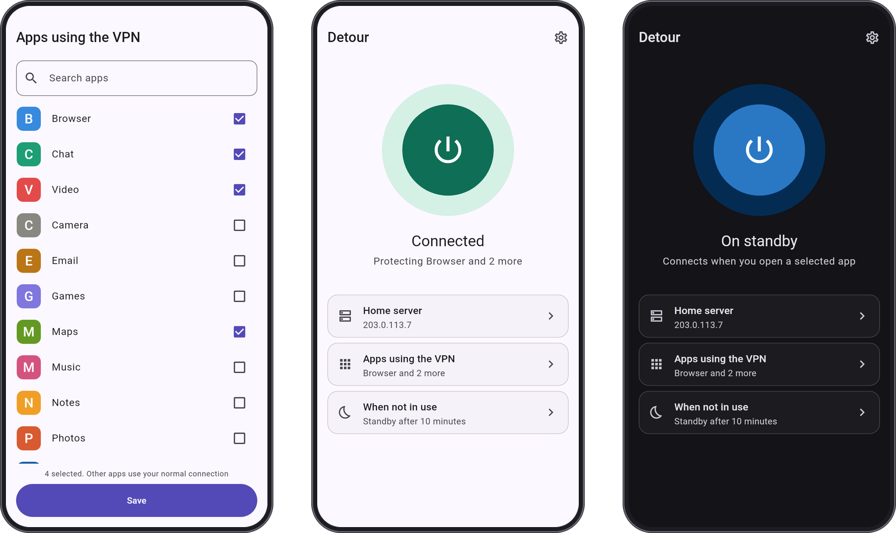
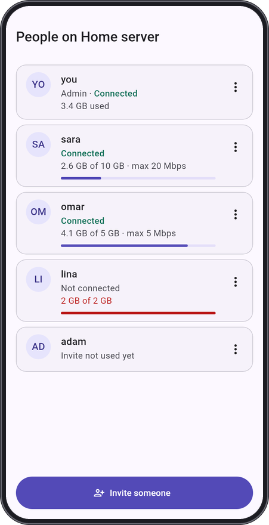

<h1 align="center">Detour</h1>

<b>Your own VPN, on your own server, for only the apps you choose.</b>

  <a href="docs/free-server.md"><b>Free server</b></a> ·
  <a href="server/README.md"><b>Server guide</b></a> ·
  <a href="packages/detour_vpn/README.md"><b>Package</b></a>

  

WireGuard is excellent, but it runs over UDP, which some networks block. OpenVPN can use TCP, but its handshake is easy to recognize, and it's hard to embed in an Android app. Detour sends everything over plain TLS on port 443, so it looks like ordinary HTTPS, with per-app control and battery saving built in.

## Customizable

- Choose which apps use the VPN, and change them while connected
- When idle: stay on, turn off, or standby, after 1 minute to 24 hours
- Many servers, each with its own apps and people
- Home-screen widget, light and dark themes
- Use the engine in your own app: [`detour_vpn`](packages/detour_vpn)

## Easy on the battery

- Sleeps until there's traffic: no polling, no standing wake lock
- One tiny ping about every 4 minutes while connected
- **Standby** drops the connection completely, and reconnects when you open a selected app

| Short idle tests | Connected | Standby |
|---|---|---|
| CPU time | 0.1 s in 4.5 min | 0.03 s in 1.5 min |
| Scheduled wake-ups | About every 4 min | None |

## Share it

- Invite people with a link that works once
- Speed and data limits per person, enforced by the server
- Remove someone and they're disconnected right away

## Secure

- Pinned server certificate, and logins encrypted with the Android Keystore
- Rate-limited logins, no traffic logs
- Selected apps wait during reconnects and standby, instead of leaking

## Quick start

1. [Set up a server](server/README.md), or [get one free](docs/free-server.md). It ends with your invite link.
2. Install the app from [Releases](https://github.com/fattymango/detour/releases/latest): `detour-android-arm64-v8a.apk` for most phones.
3. Paste the link, choose your apps, connect.

Android 8+, IPv4 only. Update the server and phones together.

## License

[MIT](LICENSE)
